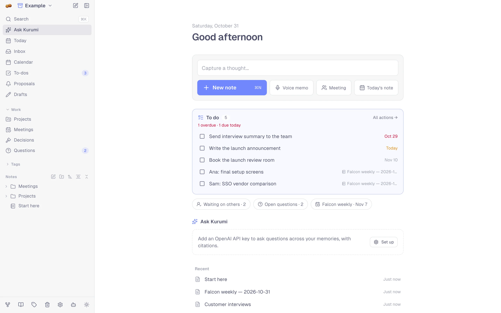
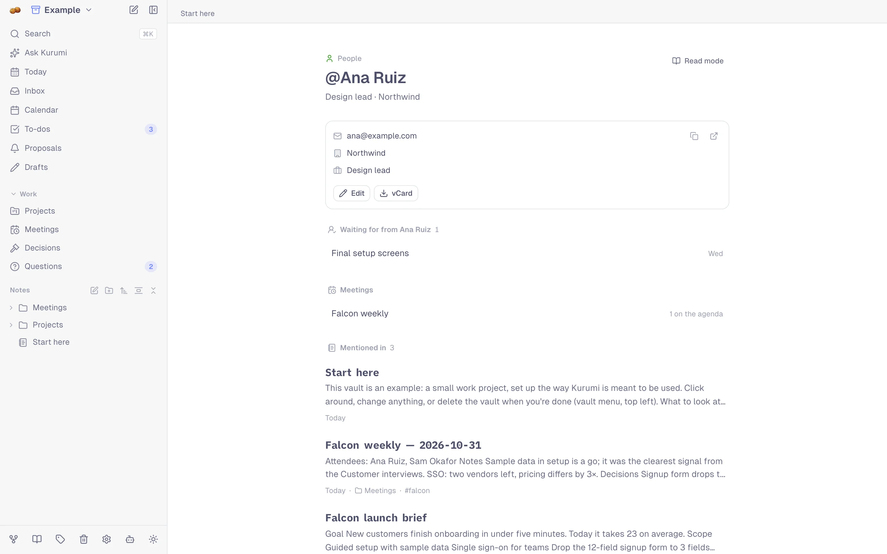
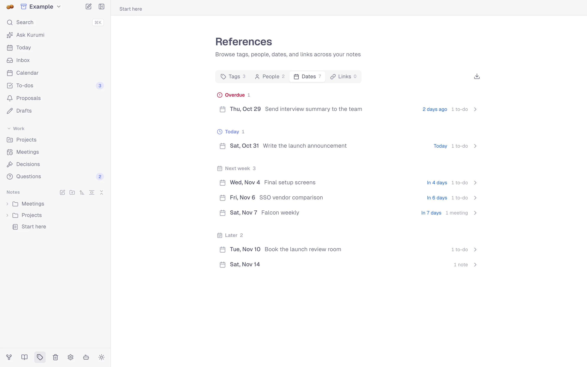

<div align="center">

<h1 align="center">
  
  <br>
  Kurumi
</h1>

<p align="center">
  <em>A local-first, AI-native second brain.</em><br>
  <em>Capture everything. Recall anything. Your data, your devices.</em>
</p>

<p align="center">
  <a href="https://svelte.dev/">
    
  </a>
  <a href="https://automerge.org/">
    
  </a>
  <a href="LICENSE">
    
  </a>
</p>

<p align="center">
  <a href="https://kurumi.raskell.io">Open Kurumi</a> •
  <a href="#what-it-does">Features</a> •
  <a href="#get-started">Get started</a> •
  <a href="#sync">Sync</a> •
  <a href="docs/README.md">Documentation</a>
</p>

<hr />

</div>

Kurumi (クルミ, "walnut" in Japanese — because it looks like a brain) is a personal memory assistant built as a local-first PWA. It captures typed notes, voice memos, and meetings, then helps you recall and act on them with AI. Everything works offline, syncs through storage you own, and routes inference between on-device models and remote APIs.

<picture>
  <source media="(prefers-color-scheme: dark)" srcset="docs/images/home-dark.webp">
  
</picture>

---

## What it does

**Capture.** A Markdown editor with `[[links]]`, `@people`, `#tags`, `//dates`, live embeds, slash commands, tables, callouts, diagrams and math. Voice memos and meetings are transcribed and summarized, with to-dos, decisions and follow-ups pulled out for you to review. Paste or drop any file; share into Kurumi from other apps; clip web pages. → [Capture](docs/capture.md) · [Editor](docs/editor.md)

**Recall.** Search by words or by meaning, ask questions answered from your notes with citations, and browse by backlinks, graph, calendar, people and references. → [Organize & recall](docs/organize-and-recall.md)

**Act.** To-dos with a list and a board, what you're waiting for from whom, projects that pull notes, to-dos, decisions and questions together, and recurring meetings with a running agenda. → [Work](docs/work.md)

<table>
  <tr>
    <td width="50%"><picture>
  <source media="(prefers-color-scheme: dark)" srcset="docs/images/project-dark.webp">
  
</picture></td>
    <td width="50%"><picture>
  <source media="(prefers-color-scheme: dark)" srcset="docs/images/meeting-series-dark.webp">
  
</picture></td>
  </tr>
  <tr>
    <td><picture>
  <source media="(prefers-color-scheme: dark)" srcset="docs/images/person-dark.webp">
  
</picture></td>
    <td><picture>
  <source media="(prefers-color-scheme: dark)" srcset="docs/images/references-dates-dark.webp">
  
</picture></td>
  </tr>
</table>

**AI, on your terms.** Whisper transcription, semantic search and small text models run in the browser and work offline. Add an OpenAI (or Anthropic, Mistral, Groq, …) key for stronger summaries, the agent that can act on your notes, and voice conversations. → [AI](docs/ai.md)

**Yours.** No account, no Kurumi server, no tracking. Data lives in your browser, syncs through storage you choose (optionally end-to-end encrypted), and exports as plain Markdown or JSON at any time. Installable, works offline, and stays fast with 10,000 notes. → [Privacy & security](docs/privacy-security.md) · [Offline & storage](docs/offline.md)

---

## Get started

Open [kurumi.raskell.io](https://kurumi.raskell.io) and install it as an app from the browser. To look around first, choose *explore an example* on the welcome screen. Bring your notes from Notion, Obsidian (or any Markdown folder), Roam or Evernote in Settings → Data.

→ [Getting started](docs/getting-started.md) · [Import & export](docs/import-export.md) · [Keyboard shortcuts](docs/keyboard-shortcuts.md)

---

## Sync

The easiest way: your own **Kurumi sync server** on a free Cloudflare account, no command line needed.

[](https://deploy.workers.cloudflare.com/?url=https://github.com/raskell-io/kurumi/tree/main/worker)

Deploy it, open its page and click *Connect Kurumi*; other devices join with the link from Settings → Sync → *Add a device*. Kurumi also syncs through Git, S3, WebDAV, Azure or a local folder, and the [sync agent](agent/README.md) keeps your vaults in any git repo using your machine's own git.

→ [Sync](docs/sync.md) · [Your own sync server](docs/sync-server.md) · [End-to-end encryption](docs/encryption.md)

---

## Documentation

All guides are in [docs/](docs/README.md): using Kurumi, sync and your data, and how it works inside ([architecture](docs/architecture.md), [development](docs/development.md)).

## Run it yourself

```bash
git clone https://github.com/raskell-io/kurumi.git
cd kurumi
npm install
npm run dev
```

Built with SvelteKit 2, Svelte 5, Automerge, Milkdown, MiniSearch and transformers.js; deploys as a static site. Tests, CI and releases: [Development](docs/development.md).

---

## Philosophy

- **Capture first, chat second.** Friction to save a thought should be near zero.
- **Local-first, not local-only.** Everything works offline; remote is the fallback.
- **Human-in-the-loop.** The assistant proposes, you approve.
- **Plain text at heart.** Markdown bodies, YAML frontmatter, exportable. No vendor lock-in.
- **Your data, your control.** No account, no tracking, and any server is yours. Export anytime.

---

## Support

If you find Kurumi useful, consider supporting its development:

<a href="https://ko-fi.com/raskell">
  
</a>

---

## License

MIT
