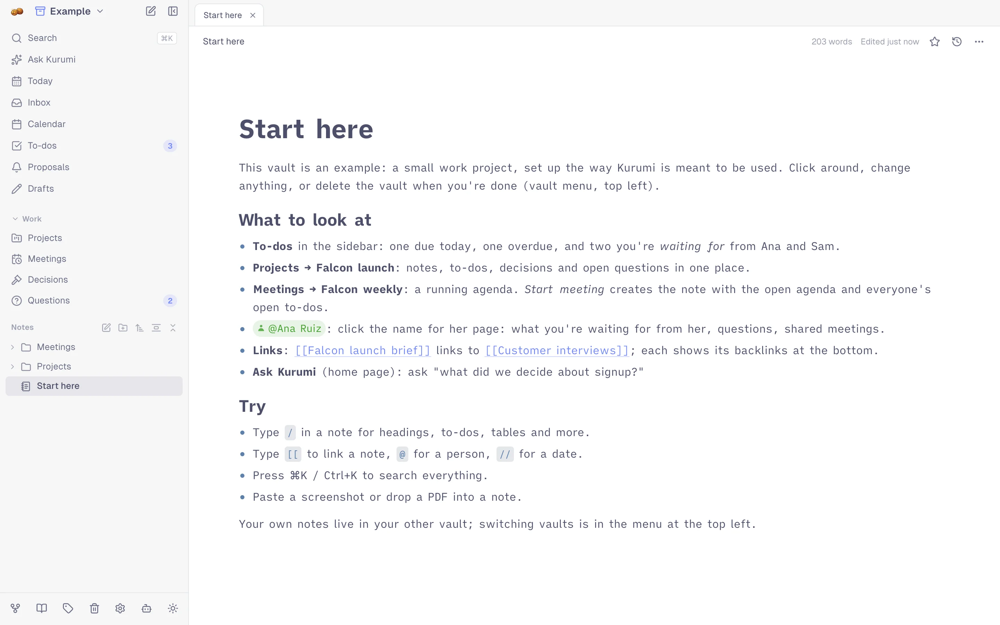
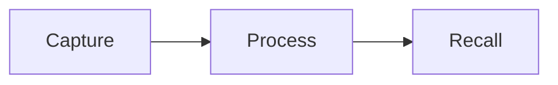

# Editor

Notes are Markdown, edited in place: what you type is formatted as you
go, and what's stored is plain Markdown you can export or read in any
editor.

<picture>
  <source media="(prefers-color-scheme: dark)" srcset="images/note-dark.webp">
  
</picture>

Settings → Appearance sets the colour theme (Catppuccin, Nord, Gruvbox,
Solarized, Rosé Pine or Plain, each light and dark), the accent colour, the
editor font, its size, and the content width: Narrow, Wide (the default) or
Full. Each device keeps its own. A **CSS snippet** there styles anything
else: `:root { --color-bg: #fcfcf9; }` changes a theme colour, any selector
works, and you can load a `.css` file.

**Vim mode** (Settings → Keyboard shortcuts) gives the editor Normal, Insert
and Visual modes: motions (`h j k l`, `w b e`, `0 ^ $`, `gg G`, with counts),
`i a I A o O`, `x r ~ J`, operators `d c y` with a motion or `iw`/`aw`, `dd yy
cc D C`, `p P`, `u` and `Ctrl+R`. A badge in the corner shows the mode.

A code block with the language `mermaid` shows a
[Mermaid](https://mermaid.js.org) diagram, in the note's colours. Click the
diagram to edit its source, and click outside to see the result:

````markdown

````

## Links and references

| Type | You get |
|------|---------|
| `[[` | A link to another note. Suggestions appear as you type; `Enter` or `Tab` picks one, `Esc` closes the list. Hover a link for a preview; Alt+click opens it beside the current note |
| `[[Title\|text]]` | The same link, showing *text* instead of the title. While the cursor isn't in it, the link reads `[[text]]` |
| `[[Title#Heading]]` | A link to a heading: the note opens there. Type `#` after a title for its headings |
| `[[Title#^a1b2c3]]` | A link to one block. A block's id is ` ^a1b2c3` at its end; the block menu's *Copy link to block* adds one |
| `![[Title]]` | The other note shown live inside this one. `![[Title#Heading]]` shows just that section, `![[Title#^id]]` just that block |
| `@` | A person. Click the name for their [person page](organize-and-recall.md#people) |
| `#` | A tag |
| `//` | A date, like `//2026-11-04`. Dates show up in the calendar and under References → Dates |

Every note lists its **backlinks** (notes linking here) and **unlinked
mentions** (notes using its title without linking) at the bottom, plus
semantically similar notes when local AI is on.

## Formatting

Markdown shortcuts work as you type: `#` + space for a heading, `-` for
a list, `1.` for a numbered list, `>` for a quote, ```` ``` ```` for code.
Selected text takes `Cmd/Ctrl+B` / `I`.

| Syntax | Result |
|--------|--------|
| `[] ` or `/checkbox` | A to-do checkbox you can click |
| `==text==` | Highlight |
| `> [!info]`, `> [!warning]`, `> [!tip]` | Callouts |
| `<details><summary>Title</summary> … </details>` | A collapsible section |
| ```` ```mermaid ```` | A diagram, rendered |
| `::::columns` | Side-by-side columns; `/columns` adds them. Type in each, any blocks |
| `$x^2$`, `$$ … $$` | Math (LaTeX), typeset by KaTeX. Typing the closing `$` turns `$…$` into a formula; click it to edit. `$$` then Enter starts a block, which shows its source while the cursor is in it. A `$` with a space after it, or a digit after the closing one, stays text: `$5 and $10` is safe |
| Tables | Pipe tables, edited in place |

## Slash commands

Type `/` for blocks: headings, lists, checkbox, quote, divider, code
block, table, two or three columns, callouts, highlight, toggle, image,
*Take photo*, embed another note, math, a date, a person, a tag, a link, a
**database** (a new one, shown in the note) and a **live query**.

**Toggle headings:** hover a heading for the caret in the margin; it folds the
section below it. Folds are kept per note on this device and don't change the
note.

**Synced blocks:** an embedded note, section or block (`![[…]]`) has *Edit*:
change it right there and it's saved in the note it comes from, so every note
showing it updates. The block menu's *Copy as synced block* gives you the
`![[Title#^id]]` to paste.

**Databases in a note:** a ```` ```database ```` block (from `/database`, or a
database's ⋯ → *Copy embed for a note*) shows a database inside the note,
with its views, filters and editing.

### Live queries

A `kurumi` code block lists notes that match a search and keeps the list
up to date:

````markdown
```kurumi
tag:falcon type:meeting after:2026-10-01
view: table
sort: updated
limit: 20
```
````

The first line is a search (same filters as `Cmd/Ctrl+K`, see
[Search filters](organize-and-recall.md#search-filters)). Options:
`view` (`list`, `table`, `board`), `group`, `sort` (`updated`, `created`,
`title`, or a property, then `asc`/`desc`) and `limit` (up to 200). For
[databases](organize-and-recall.md#databases):

````markdown
```kurumi
from: Reading list
where: Status = Done
where: Rating >= 4
sort: Rating desc
show: Status, Rating
view: table
```
````

`from` is a database (or folder) by name. `where` lines all have to hold:
`=`, `!=`, `>`, `<`, `>=`, `<=`, `before`, `after`, `contains`, `is empty`,
`is not empty`, a checkbox's name alone (`where: Fiction`) or `not Fiction`;
`today` stands for today's date. `show` picks the table's columns and
`group` can be a property. In the editor the results show live; click them
to edit the query.

## Blocks

Hover a block to get two handles in the margin:

- **`+`** adds a block below.
- **`⋮⋮`** drags the block somewhere else, or opens a menu: *Turn into*
  (paragraph, heading, list, quote, code, …), *Copy link to block*, *Copy as
  synced block*, *Duplicate*, *Delete*.

## Find and replace

- `Cmd/Ctrl+F` finds in the current note.
- `Cmd/Ctrl+Option/Alt+F` replaces, in this note or **across all notes**.
  Replacing across notes can be undone with `Cmd/Ctrl+Z`.

## Pasting

- **From ChatGPT, web pages, Google Docs:** headings, lists, tables, code
  and links are kept, the page's styling isn't.
- **From a Markdown editor:** the Markdown is used as is.
- **From VS Code:** code stays a code block.
- **A URL over selected text** turns the text into a link.
- **Images and files:** see [Files and images](capture.md#files-and-images).

## Two notes side by side

Alt+click a note in the tree or a `[[link]]` to open it in a split pane.
Both panes reload when the note changes elsewhere, unless you're typing
in it.

## History

Every note keeps its earlier versions: the clock icon in the note header
lists them, and you can restore any of them.

## On a phone

A formatting bar sits above the on-screen keyboard: headings, lists,
checkboxes, bold, links and more.
