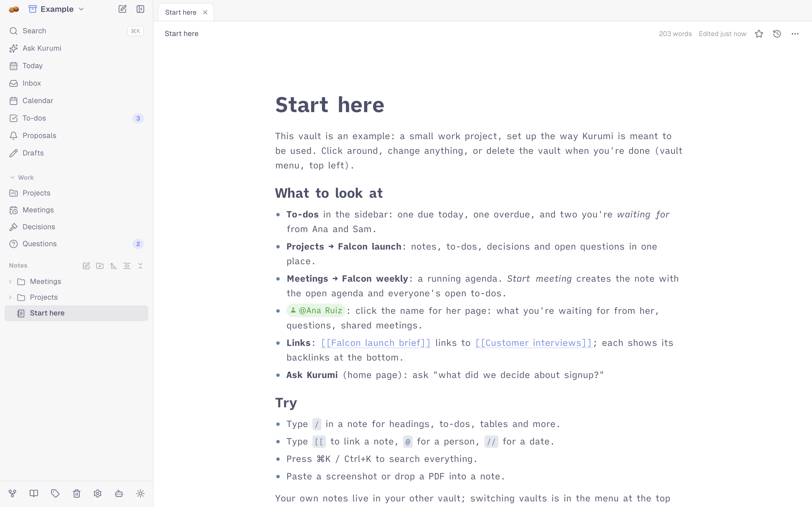

# Editor

Notes are Markdown, edited in place: what you type is formatted as you
go, and what's stored is plain Markdown you can export or read in any
editor.

<picture>
  <source media="(prefers-color-scheme: dark)" srcset="images/note-dark.webp">
  
</picture>

## Links and references

| Type | You get |
|------|---------|
| `[[` | A link to another note. Suggestions appear as you type; `Enter` or `Tab` picks one, `Esc` closes the list. Hover a link for a preview; Alt+click opens it beside the current note |
| `![[Title]]` | The other note shown live inside this one |
| `@` | A person. Click the name for their [person page](organize-and-recall.md#people) |
| `#` | A tag |
| `//` | A date, like `//2026-11-04`. Dates show up in the calendar and under References → Dates |

Every note lists its **backlinks** (notes linking here) and **unlinked
mentions** (notes using its title without linking) at the bottom, plus
semantically similar notes when local AI is on.

## Formatting

Markdown shortcuts work as you type: `#` + space for a heading, `-` for
a list, `1.` for a numbered list, `>` for a quote, ```` ``` ```` for code.
Selected text takes `Cmd/Ctrl+B` / `I`.

| Syntax | Result |
|--------|--------|
| `[] ` or `/checkbox` | A to-do checkbox you can click |
| `==text==` | Highlight |
| `> [!info]`, `> [!warning]`, `> [!tip]` | Callouts |
| `<details><summary>Title</summary> … </details>` | A collapsible section |
| ```` ```mermaid ```` | A diagram, rendered |
| `$x^2$`, `$$ … $$` | Inline and block math (LaTeX) |
| Tables | Pipe tables, edited in place |

## Slash commands

Type `/` for blocks: headings, lists, checkbox, quote, divider, code
block, table, callouts, highlight, toggle, image, *Take photo*, embed
another note, math, a date, a person, a tag, a link, and a **live
query**.

### Live queries

A `kurumi` code block lists notes that match a search and keeps the list
up to date:

````markdown
```kurumi
tag:falcon type:meeting after:2026-10-01
view: table
sort: updated
limit: 20
```
````

The first line is a search (same filters as `Cmd/Ctrl+K`, see
[Search filters](organize-and-recall.md#search-filters)). Options:
`view` (`list`, `table`, `board`), `group`, `sort` (`updated`, `created`,
`title`) and `limit` (up to 200).

## Blocks

Hover a block to get two handles in the margin:

- **`+`** adds a block below.
- **`⋮⋮`** drags the block somewhere else, or opens a menu: *Turn into*
  (paragraph, heading, list, quote, code, …), *Duplicate*, *Delete*.

## Find and replace

- `Cmd/Ctrl+F` finds in the current note.
- `Cmd/Ctrl+Option/Alt+F` replaces, in this note or **across all notes**.
  Replacing across notes can be undone with `Cmd/Ctrl+Z`.

## Pasting

- **From ChatGPT, web pages, Google Docs:** headings, lists, tables, code
  and links are kept, the page's styling isn't.
- **From a Markdown editor:** the Markdown is used as is.
- **From VS Code:** code stays a code block.
- **A URL over selected text** turns the text into a link.
- **Images and files:** see [Files and images](capture.md#files-and-images).

## Two notes side by side

Alt+click a note in the tree or a `[[link]]` to open it in a split pane.
Both panes reload when the note changes elsewhere, unless you're typing
in it.

## History

Every note keeps its earlier versions: the clock icon in the note header
lists them, and you can restore any of them.

## On a phone

A formatting bar sits above the on-screen keyboard: headings, lists,
checkboxes, bold, links and more.
