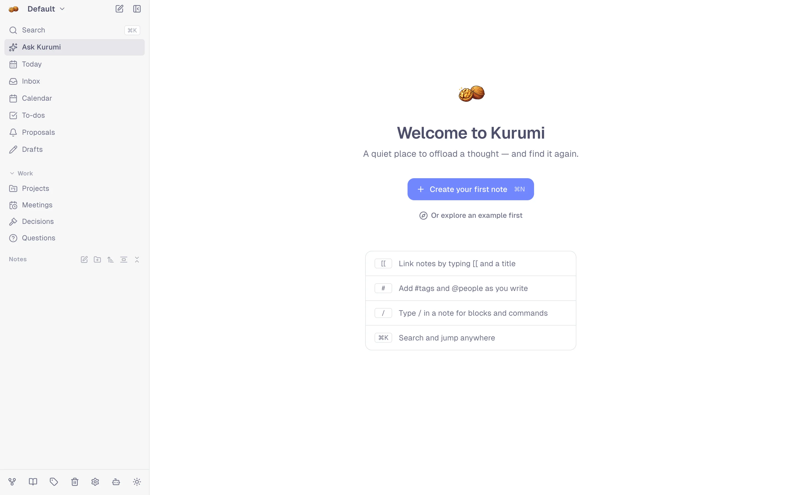

# Getting started

## Open or install Kurumi

Kurumi runs at [kurumi.raskell.io](https://kurumi.raskell.io). There is
no account: what you write is stored in this browser on this device.

Installing it as an app gives it its own window, an icon and some extras
(sharing into it, opening `.md` files, a badge with your due to-dos):

- **Chrome / Edge:** the install icon in the address bar, or menu → *Install Kurumi*.
- **Safari on Mac:** File → *Add to Dock*.
- **iPhone / iPad:** Share → *Add to Home Screen*.
- **Android:** menu → *Install app*.

What each platform supports is in [Offline & storage](offline.md#what-each-platform-supports).

<picture>
  <source media="(prefers-color-scheme: dark)" srcset="images/welcome-dark.webp">
  
</picture>

## Look around first

On the welcome screen choose **explore an example**, or press `Cmd/Ctrl+K`
and run *Explore example vault*. Kurumi creates a separate vault called
`Example` with a project, a recurring meeting, to-dos, decisions, open
questions and people, all dated relative to today. Your own notes stay in
their vault; switch between vaults in the sidebar, and delete `Example`
when you're done.

## Find your way around

- **Sidebar:** vaults, favorites, the folder tree, and the main sections
  (Home, Inbox, To-dos, Projects, Meetings, Decisions, Questions, …).
- **`Cmd/Ctrl+K`:** search everything and run any command. With an empty
  query it shows the notes you opened recently.
- **`Cmd/Ctrl+N`:** a new note. **`Cmd/Ctrl+D`:** today's daily note.
- **Home:** Ask Kurumi (a question answered from your notes, with
  citations) and what's due today.
- **Settings (`Cmd/Ctrl+,`):** one page per section: Appearance, Profile,
  Sync, Local AI, AI assistant, Notifications, Keyboard shortcuts, Data,
  Offline & storage, Labs, About, Danger zone.

Put your name in **Settings → Profile**. Kurumi uses it to tell your
to-dos from the ones you're [waiting for](work.md#waiting-for).

## Bring your notes

Settings → **Data** imports Notion, Obsidian, Roam Research and Evernote
exports, or a JSON backup from another Kurumi. See
[Import & export](import-export.md).

## Use it on more than one device

Data stays on each device until you set up [sync](sync.md). The easiest
option is [your own Kurumi sync server](sync-server.md): one click on a
free Cloudflare account, then a link for each further device.

## Next

- [Capture](capture.md) and the [editor](editor.md) for writing.
- [Work](work.md) if you use Kurumi for meetings and projects.
- [AI](ai.md) to choose what runs on your device and what doesn't.
