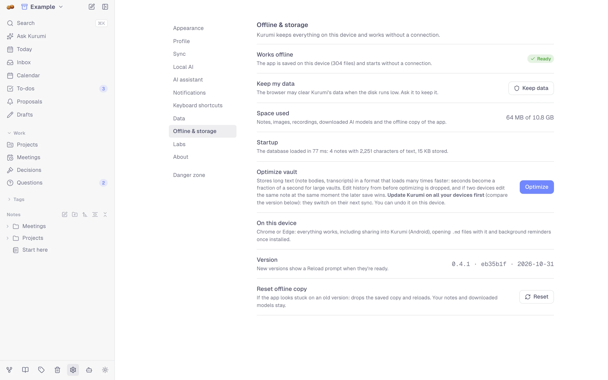

# Offline & storage

Kurumi is a web app that works like an installed one: after the first
visit it starts and runs without a connection, and everything you write
is stored on the device.

<picture>
  <source media="(prefers-color-scheme: dark)" srcset="images/settings-offline-dark.webp">
  
</picture>

## Install it

See [Getting started](getting-started.md#open-or-install-kurumi). Installed,
Kurumi gets its own window and icon, and each launch (a share, an opened
file, an icon shortcut) reuses the open window instead of a new one.

## What each platform supports

| | Chrome / Edge (desktop, Android) | Safari (Mac) | iPhone / iPad (home screen) | Firefox |
|---|---|---|---|---|
| Notes, search, to-dos, offline | ✓ | ✓ | ✓ | ✓ |
| Install as an app | ✓ | ✓ (Dock) | ✓ | — |
| Share into Kurumi from other apps | Android | — | — | — |
| Open `.md` files with Kurumi | desktop | — | — | — |
| Due to-do reminders in the background | ✓ | — | — | — |
| Local folder sync | desktop | — | — | — |

Apple doesn't give web apps the share sheet, file opening or background
checks, so on iPhone and iPad those need Kurumi open. Settings → Offline
& storage → *On this device* says what applies to the browser you're in.

## Updates

New versions download in the background. When one is ready, a
*Reload* prompt appears; Kurumi never reloads by itself, so you won't
lose a sentence mid-edit. The version you're running is in Settings →
Offline & storage and About.

If the app ever looks stuck on an old version, Settings → Offline &
storage → **Reset offline copy** drops the cached app and reloads. Notes
and downloaded models stay.

## AI offline

Local AI models are cached after their first download. Settings → Local
AI → **Download all** fetches every enabled model in one go. See
[AI](ai.md).

## Storage

Notes, files, recordings, AI models and the app itself are stored in the
browser's storage for this site. **Space used** shows how much, against
what the browser allows.

Browsers may clear a site's data when the disk runs low, unless the site
is allowed to keep it. Kurumi asks for that when it starts; **Keep data**
asks again. Installed apps usually get it automatically.

Even so, a browser profile is not a backup: [sync](sync.md) to another
device or storage, or export regularly ([Import & export](import-export.md)).

## Optimize a big vault

**Startup** shows how long the database took to load and how much text it
holds. Kurumi's default storage keeps a full edit history of every
character, which makes merging precise but loading slower as a vault
grows: around 0.65 seconds per million characters.

**Optimize** stores long text (note bodies, transcripts, summaries) in a
compact format. Measured on 10,000 notes, the database loaded in 0.9 s
instead of 11.9 s. What you give up:

- edit history from before optimizing, including the earlier versions a
  note's History lists (new versions are recorded from then on);
- character-level merging of the same note: if two devices edit the same
  note at the same moment, the later save wins.

Before you optimize:

1. **Update Kurumi on all your devices** to the same version (compare the
   version line). Older versions can't read an optimized vault and will
   ask to update.
2. Optimize on one device. The others switch on their next sync.

**Undo** brings back the database from before optimizing, keeping
anything you changed since. Small vaults load fast either way; optimizing
is for when *Startup* gets slow.
