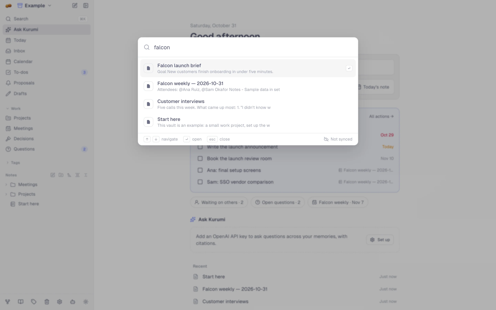
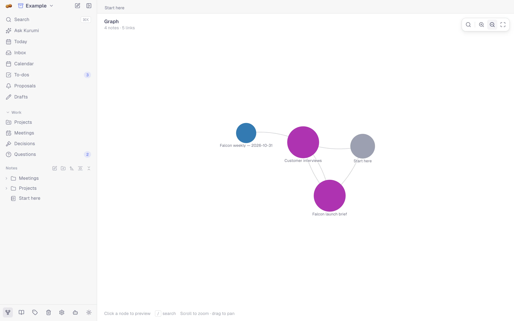

# Organize & recall

Folders are for browsing; links, tags and people are how Kurumi connects
things. You don't have to file a note to find it again.

## Vaults

A vault is a separate set of notes, folders, people and to-dos: work and
personal, say. Switch, create, rename or delete vaults from the menu at
the top of the sidebar, and give each an icon or your own logo. Sync
carries every vault.

## Folders and the tree

Folders nest without limit. In the sidebar tree:

- drag notes and folders to move them;
- hover a row for `+` (new note inside) and `⋯` (rename, copy
  `[[link]]`, move, delete); right-click works too;
- swipe a row left on touch screens to delete it;
- Alt+click a note to open it beside the current one.

Large folders show 200 notes and a *Show more* button.

## Favorites, icons and tabs

- **Favorites:** the star in a note's header pins it to the top of the
  sidebar.
- **Icons:** give a note an emoji or an image; it shows in the tree, tabs,
  the switcher and link previews.
- **Tabs:** the notes you open line up as tabs above the editor. Drag to
  reorder, middle-click to close.

## Tags, people and topics

- **Tags** come from `#hashtags`. `/tags` finds duplicates, merges and
  renames them (every note is updated) and points out tags used only once.
- **People** are everyone you `@mention`. `/people` lists them, finds
  likely duplicates (`@Ana` and `@Ana Ruiz`) and merges them across all
  notes, meeting participants and to-dos.
- **Topics and projects** found in recordings can be deduplicated the
  same way in `/topics`.

### People

Each person has a page (click any `@mention`): contact details (with a
vCard download), what you're [waiting for](work.md#waiting-for) from
them, open questions, the recurring meetings you share, and every note
that mentions them.

<picture>
  <source media="(prefers-color-scheme: dark)" srcset="images/person-dark.webp">
  
</picture>

## Search

`Cmd/Ctrl+K` searches titles and text as you type, and runs commands
(*New voice memo*, *Explore example vault*, …). With an empty query it
shows recently opened notes. `Cmd/Ctrl+O` / `P` is a quick switcher.

<picture>
  <source media="(prefers-color-scheme: dark)" srcset="images/command-palette-dark.webp">
  
</picture>

With local AI on, search also finds notes by **meaning**: "budget
worries" finds the note that says "we can't afford the second vendor".

### Search filters

These work in search, in [live queries](editor.md#live-queries) and in
smart folders. Repeating one means *either*; different ones must all
match.

| Filter | Matches |
|--------|---------|
| `tag:work` | Notes tagged `#work` |
| `person:"Ana Ruiz"` | Notes mentioning or attended by Ana |
| `folder:projects` | Notes in a folder whose name contains *projects* |
| `type:meeting` | `note`, `voice-memo`, `meeting`, … |
| `after:2026-10-01`, `before:2026-11-01` | Created after / before that day |
| `has:audio`, `has:transcript`, `has:summary`, `has:meeting` | Notes with that part |

## Ask Kurumi

On the home page, ask a question in plain words. Kurumi finds the
relevant notes (keyword and meaning search together), answers from them
and cites each source as `[1]`, `[2]`, … linking to the note. Follow-up
questions keep the conversation. It needs an AI provider; see
[AI](ai.md).

<picture>
  <source media="(prefers-color-scheme: dark)" srcset="images/home-dark.webp">
  
</picture>

## References

`/references` (`Cmd/Ctrl+R`) gathers what your notes point at: **tags**,
**people**, **links** to the web, and **dates**: every `//date`, event,
open to-do by due date and the next date of each recurring meeting,
grouped into overdue, today, next week and later.

<picture>
  <source media="(prefers-color-scheme: dark)" srcset="images/references-dates-dark.webp">
  
</picture>

## Graph

`/graph` (`Cmd/Ctrl+G`) draws notes as dots and links as lines. Click a
dot to preview the note, `/` to search, scroll to zoom.

<picture>
  <source media="(prefers-color-scheme: dark)" srcset="images/graph-dark.webp">
  
</picture>

## Other ways in

- **Read mode** (`/read`, `Cmd/Ctrl+Shift+R`): notes as a blog to scroll
  through, filtered by folder, tag, date, person or topic.
- **Calendar** (`Cmd/Ctrl+Shift+C`): notes, memos, meetings and due
  to-dos per day.
- **Weekly review** (`/review`): what you captured, what's overdue, what
  still needs a decision, and an AI summary of the week.
- **Trash:** deleted notes wait here until you restore or empty them.
