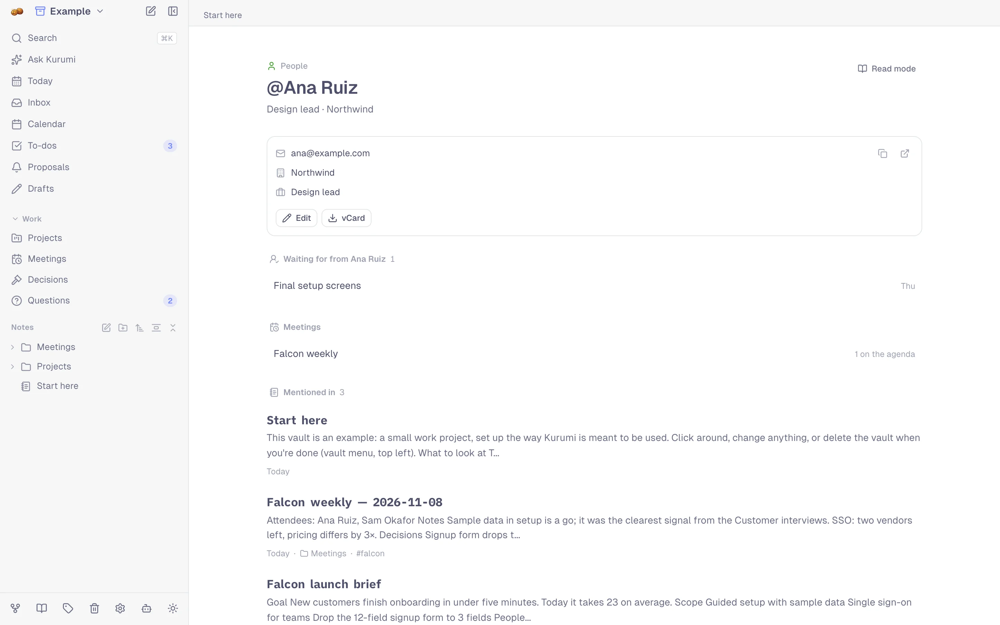
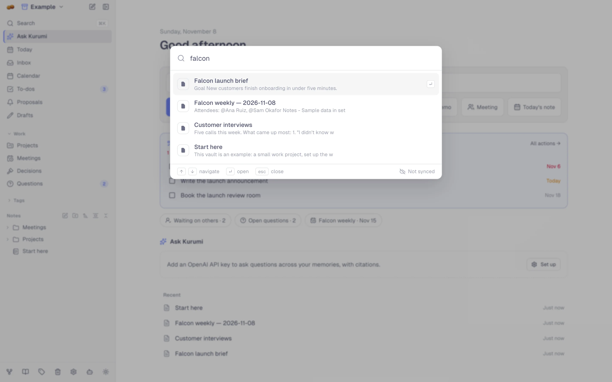
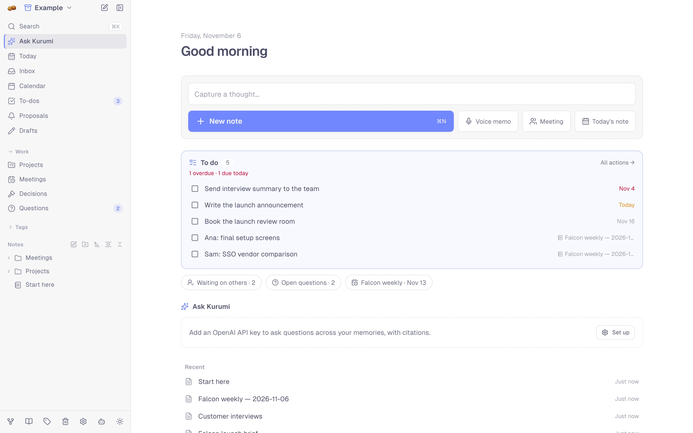
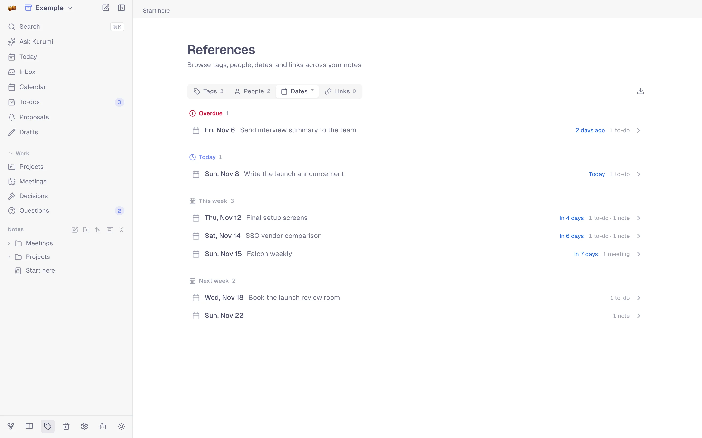
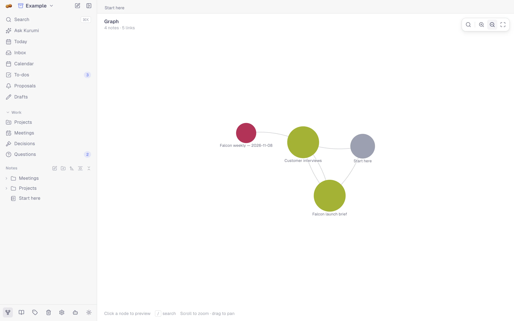

# Organize & recall

Folders are for browsing; links, tags and people are how Kurumi connects
things. You don't have to file a note to find it again.

## Vaults

A vault is a separate set of notes, folders, people and to-dos: work and
personal, say. Switch, create, rename or delete vaults from the menu at
the top of the sidebar, and give each an icon or your own logo. Sync
carries every vault.

## Folders and the tree

Folders nest without limit. In the sidebar tree:

- drag notes and folders to move them;
- hover a row for `+` (new note inside) and `⋯` (rename, copy
  `[[link]]`, move, delete); right-click works too;
- swipe a row left on touch screens to delete it;
- Alt+click a note to open it beside the current one.

Large folders show 200 notes and a *Show more* button.

## Databases

Any folder can be a database: right-click it → *Open as database*, or
⌘K → *New database*. Its notes are the rows, and you add properties:
text, number, select, multi-select, date, checkbox, URL, person, and:

- **Relation:** links to rows of another database (or any note). Pick them
  from a list; typing a new name adds a row there.
- **Rollup:** sums up a relation: count, sum, average, min, max, earliest or
  latest date, percent checked, or the values themselves.
- **Formula:** worked out per row, e.g. `prop("Points") * 2`,
  `if(prop("Done"), "✓", "")`, `dateBetween(prop("Due"), today(), "days")`.
  Text, maths, logic and date functions; the editor shows the result for
  the first row as you type.

- **Views:** table and list (both can be grouped by any property), board
  (grouped by a select property; drag cards between columns), gallery,
  calendar (by a date property; drag to another day) and timeline (from a
  start to an end date; drag a bar to move it, its end to change its length).
  Add views as tabs; each keeps its own filters, sort and shown properties,
  and all share the properties.
- **Templates:** the arrow next to *New* adds rows from a template (a title,
  where `{date}` is today, a body and property values).
- **In a note:** `/database`, or the database's ⋯ → *Copy embed for a note*.
- **Editing:** click a cell. In a select, type a new option to add it.
  *New* adds a row (a note in the folder); a row passing a view's
  filters keeps their values.
- **On the note:** a row's properties sit under its title, editable.
- A database folder has a database icon in the tree; click it to open
  the database. *Turn back into a folder* (view ⋯ menu) removes the
  views; the values stay on the notes.

Properties sync with every method. In git sync they're merged per note,
the side that changed them last winning.

## Canvas

A canvas is a board for thinking spatially: ⌘K → *New canvas*, or a folder's
menu → *New canvas*. Double-click the board for a text card (Markdown), or add
a note, a link or a group from the toolbar. Select a card to resize or colour
it, and drag one of its side dots onto another card to connect them; a
connection can have a label and an arrow. Drag the board to pan, scroll or
pinch to zoom. Canvases use Obsidian's open JSON Canvas format: Obsidian's
`.canvas` files import with the vault, and the Markdown export writes them
back.

## Favorites, icons and tabs

- **Favorites:** the star in a note's header pins it to the top of the
  sidebar.
- **Icons:** give a note an emoji or an image; it shows in the tree, tabs,
  the switcher and link previews.
- **Tabs:** the notes you open line up as tabs above the editor. Drag to
  reorder, middle-click to close. **Pin** the ones you're working on (the
  pin on a tab, right-click, or ⌘K *Pin this note as a tab*): pinned tabs
  stay on the left, come back after a restart and are never pushed out
  by newer tabs. Pins are kept per device.

## Tags, people and topics

- **Tags** come from `#hashtags`. `/tags` finds duplicates, merges and
  renames them (every note is updated) and points out tags used only once.
- **People** are everyone you `@mention`. `/people` lists them, finds
  likely duplicates (`@Ana` and `@Ana Ruiz`) and merges them across all
  notes, meeting participants and to-dos.
- **Topics and projects** found in recordings can be deduplicated the
  same way in `/topics`.

### People

Each person has a page (click any `@mention`): contact details (with a
vCard download), what you're [waiting for](work.md#waiting-for) from
them, open questions, the recurring meetings you share, and every note
that mentions them.

<picture>
  <source media="(prefers-color-scheme: dark)" srcset="images/person-dark.webp">
  
</picture>

## Search

`Cmd/Ctrl+K` searches titles and text as you type, and runs commands
(*New voice memo*, *Explore example vault*, …). With an empty query it
shows recently opened notes. `Cmd/Ctrl+O` / `P` is a quick switcher.

<picture>
  <source media="(prefers-color-scheme: dark)" srcset="images/command-palette-dark.webp">
  
</picture>

With local AI on, search also finds notes by **meaning**: "budget
worries" finds the note that says "we can't afford the second vendor".

### Search filters

These work in search, in [live queries](editor.md#live-queries) and in
smart folders. Repeating one means *either*; different ones must all
match.

| Filter | Matches |
|--------|---------|
| `tag:work` | Notes tagged `#work` |
| `person:"Ana Ruiz"` | Notes mentioning or attended by Ana |
| `folder:projects` | Notes in a folder whose name contains *projects* |
| `type:meeting` | `note`, `voice-memo`, `meeting`, … |
| `after:2026-10-01`, `before:2026-11-01` | Created after / before that day |
| `has:audio`, `has:transcript`, `has:summary`, `has:meeting` | Notes with that part |

## Ask Kurumi

On the home page, ask a question in plain words. Kurumi finds the
relevant notes (keyword and meaning search together), answers from them
and cites each source as `[1]`, `[2]`, … linking to the note. Follow-up
questions keep the conversation. It needs an AI provider; see
[AI](ai.md).

<picture>
  <source media="(prefers-color-scheme: dark)" srcset="images/home-dark.webp">
  
</picture>

## References

`/references` (`Cmd/Ctrl+R`) gathers what your notes point at: **tags**,
**people**, **links** to the web, and **dates**: every `//date`, event,
open to-do by due date and the next date of each recurring meeting,
grouped into overdue, today, next week and later.

<picture>
  <source media="(prefers-color-scheme: dark)" srcset="images/references-dates-dark.webp">
  
</picture>

## Graph

`/graph` (`Cmd/Ctrl+G`) draws notes as dots and links as lines. Click a
dot to preview the note, `/` to search, scroll to zoom.

<picture>
  <source media="(prefers-color-scheme: dark)" srcset="images/graph-dark.webp">
  
</picture>

## Other ways in

- **Read mode** (`/read`, `Cmd/Ctrl+Shift+R`): notes as a blog to scroll
  through, filtered by folder, tag, date, person or topic.
- **Highlights** (`/read/highlights`, or *Highlights* on the Read page,
  ⌘K *Study highlights*): every `==highlighted==` passage across your
  notes, and every PDF highlight, in one document grouped by note, with
  the sentence around it and the heading it's under. Filter by words or
  tag, shuffle, or turn on **Quiz** to hide each highlight in its sentence
  until you click it. *Save as note* keeps the collection as quotes.
- **Calendar** (`Cmd/Ctrl+Shift+C`): notes, memos, meetings and due
  to-dos per day.
- **Weekly review** (`/review`): what you captured, what's overdue, what
  still needs a decision, and an AI summary of the week. The first time
  you open Kurumi in a new week it also writes a **review note** for the
  week before (Monday to Sunday): meetings, decisions, what got done,
  projects you worked on, what's still open (overdue, waiting for others,
  open questions) and what's due the week after, with a short AI recap
  when an AI provider is set up. Quiet weeks get no note. `/review` links
  it or writes it for the week shown; ⌘K *Write weekly review* and the
  agent chat can write it too. Writing it again replaces it.
- **Trash:** deleted notes wait here until you restore or empty them.
