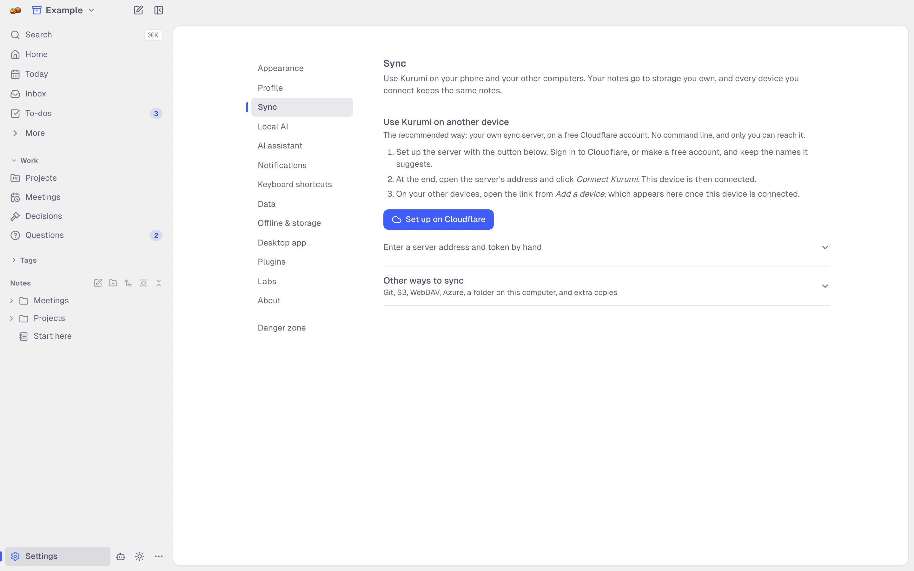

# Sync

Each device keeps its own full copy of your notes. Sync exchanges copies
through storage **you** choose, and merges them so edits from every
device survive: there's no Kurumi account or Kurumi cloud.

<picture>
  <source media="(prefers-color-scheme: dark)" srcset="images/settings-sync-dark.webp">
  
</picture>

## Pick a method

| Method | Good for | Setup |
|--------|----------|-------|
| **Kurumi server** | Most people: phone + laptop, no command line | [One click on a free Cloudflare account](sync-server.md) |
| **Local** + [sync agent](../agent/README.md) | A git repo of plain Markdown at work, using your own git and SSH keys | A folder and one command |
| **Git** | A git repo, from the browser alone | A repo and a personal access token |
| **S3** | Storage you already have (AWS, R2, MinIO, Backblaze, …) | Endpoint, bucket, keys |
| **WebDAV** | Nextcloud, Synology, ownCloud | Address, user, password |
| **Azure** | Azure Blob Storage | Account URL, container, SAS token |
| **Local** alone | One computer, a backup folder, or a folder another tool syncs | Choose a folder (Chrome/Edge) |

Choose the **primary method** in Settings → Sync. **Mirrors** (optional)
receive a copy after every successful sync, one way, e.g. a nightly
backup to S3 while the Kurumi server is primary. Git can't be a mirror.

## When sync runs

Once a method is set up, Kurumi syncs:

- a few seconds after you stop typing;
- when you come back to the app (tab or window shown again);
- when the device comes back online (sync waits while offline; the sync
  button says *Offline*);
- when you press the sync button.

Two syncs are at least 10 seconds apart.

## What's synced

- **The database:** every vault, note, folder, person, to-do, project,
  meeting, decision and question, as one file.
- **Files:** images, recordings and attachments of the vault you're in,
  each stored once. A file that hasn't arrived yet shows a notice instead
  of a broken link.
- **Not synced:** settings that belong to a device (theme, shortcuts,
  AI keys, local models, your profile names).

## How edits merge

The database is a CRDT ([Automerge](https://automerge.org/)): each
device records its changes, and merging two copies replays both sides.
Edits to different notes, or different parts of a note, all survive. If
two devices change the same text at the same moment, both changes are
kept; for a single value like a status or a due date, one of the two
wins, the same one on every device.

Two copies that never synced before (Kurumi used on two devices before
setting up sync) are combined record by record, keeping the newer
version of each. Kurumi also does this when one device has
[optimized](offline.md#optimize-a-big-vault) the vault and another hasn't
synced since.

A copy made by a newer Kurumi version is never merged into an older app:
the older one asks you to reload and update first.

## Method details

### Kurumi server

A Cloudflare Worker and an R2 bucket on your own account. See
[Your own sync server](sync-server.md). Supports
[end-to-end encryption](encryption.md).

### Git

Settings → Sync → Git: repository URL (GitHub, GitLab or Codeberg),
branch, and a personal access token with read/write access to that repo.

- Notes are written as Markdown files mirroring your folders, plus
  `.kurumi/metadata.json` (folders, people, events, to-dos) and
  `.kurumi/blobs/` (files).
- The browser talks to the git host through a CORS proxy
  (`cors.isomorphic-git.org`), and the token is stored in the browser.
  If either is a problem (often at work), use **Local + the sync agent**.
- When the same note was changed on both sides since the last sync,
  Kurumi shows both versions side by side and lets you pick or combine.

### Local folder + sync agent

Settings → Sync → Local: choose a folder (Chrome and Edge). Kurumi writes
`kurumi-sync.bin` (the database) and a Markdown copy of the vault; turn on
**Write all vaults** for one subfolder per vault. The panel shows the
folder's name, when Kurumi last wrote there and what it contains; browsers
don't reveal its full path. If a file can't be written (on Windows, a path that's
too long or a reserved name like `con`), the rest still syncs and the panel names it.

Kurumi also reads the folder back:

- editing a note's text or tags in the `.md` file changes the note;
- a new `.md` file becomes a note, a new folder becomes a folder, and with
  *Write all vaults* a new top-level folder becomes a vault;
- to-dos, people, events, projects, decisions, questions and meetings added
  to `.kurumi/metadata.json`, and files added to `.kurumi/blobs/`, are
  picked up too.

The [sync agent](../agent/README.md) commits that folder and pushes and
pulls it with your machine's git. It merges `kurumi-sync.bin` with the
same CRDT merge, so edits from several computers survive.

### Working with coding agents

With the local folder or Git, a coding agent such as Claude Code or Codex
can add notes, images, files, to-dos and everything else without opening
Kurumi. Every sync writes `.kurumi/AGENTS.md` next to `metadata.json`,
describing what to use when, the file formats, and what can and can't be done
from files. Anything the agent only inferred should arrive as a proposal for you
to approve.
Sync also writes `.claude/CLAUDE.md` at the top of the folder, so Claude Code
started there follows the guide by itself; instructions you've put in that file
stay. Other agents don't load a guide from `.kurumi/`, so point them at it:
*"Read `.kurumi/AGENTS.md`, then add a to-do for…"*.

While Kurumi is open it notices changes in a local folder within about 15
seconds, and writes its own there just as quickly, so you and an agent can work
at the same time. If both edit a note, changes to different lines are merged; if
both change the same lines, the agent's text becomes a separate note. Sync never
deletes a file: one it has to remove, like the old name of a renamed note, moves
to `.kurumi/archive/`. When Kurumi was closed it catches up on
opening, though the browser may first want a click on **Sync now** to allow the
folder again. With Git, changes arrive at the next pull.

### S3, WebDAV, Azure

Fill in the connection details and press **Test connection**. All three
support
[end-to-end encryption](encryption.md).

## Linked folders (desktop app)

A linked folder is not sync. It is a folder of Markdown notes on your computer
(a knowledge base, a repository of notes kept by other tools) that the desktop
app shows as a vault, reading the files where they are. Kurumi keeps no copy of
them: they aren't in its database, in backups or in anything it syncs. It only
reads the folder unless you allow editing.

How it differs from *Local folder* sync above: there, Kurumi's database is the
original and the folder a mirror Kurumi writes; here the folder is the original
and Kurumi works on it. A Kurumi sync folder can't be linked. Linked folders
exist only on the computer they were linked on, and only in the desktop app.

### Linking

Vault menu → **Link a folder…** (or ⌘K → *Link a folder as a vault*), choose
the folder, and check what Kurumi suggests from the notes it finds:

- **Link key field**: the frontmatter field a `[[link]]` names a note by, such
  as `id: project.foo`. Titles and filenames work as well. Empty: links go by
  title only.
- **Frontmatter fields**: which field holds the title (otherwise the first
  heading, then the filename) and the summary, and which become tags
  (`type: project` → `type/project`; a `tags` list is always read).
- **Files left out**: patterns as in a `.gitignore`; the folder's own
  `.gitignore` can be followed too. Hidden files and folders are always left
  out.
- **Allow editing**: off at first. See below.

The same dialog (the pencil beside the vault) later shows how many notes were
found, keys used by more than one note, and whether the folder is being
watched, and has **Rescan**, **Reveal** (the folder in the file manager),
**Locate…** (if the folder moved) and **Unlink**, which makes Kurumi forget
the folder without touching it.

### Reading

- Read, search, follow links and backlinks, browse tags, use the graph, Read
  mode and Ask Kurumi. With a remote AI provider set up, text from these notes
  is sent to it when you ask about them, as for your other vaults.
- A link written by its key (`[[project.foo]]`) shows the note's title; in
  the editor, put the cursor in it to see what is written. The frontmatter of
  a note is listed under its title.
- Pictures and recordings a note refers to by a path in the folder are shown
  (``, ``, or `/images/a.png` from
  the top of the folder), up to 25 MB each. A link to another file of the
  folder opens it; a link to another note by its path goes there. (In a note
  you can edit, hold ⌘/Ctrl while clicking such a link.)
- Changes made in the folder by other programs show up while Kurumi is open:
  notes and the pictures they show within about a second (on a disk that
  can't be watched, a replaced picture when a note changes or you come back
  to Kurumi's window). If watching the folder fails, Kurumi tries
  again a few times; after that the vault's dialog says so and **Rescan**
  reads the folder again.
- **Reveal in file manager** in a note's menu shows its file.
- If the folder isn't there at start (moved, disk unplugged), Kurumi says so,
  shows your Kurumi vault and keeps the link for later.

### Editing

With *Allow editing* on:

- Saving a note changes only the lines you edited. The frontmatter stays byte
  for byte, as do line endings and blank lines; a note you only looked at is
  never written. (A line you edit is written the way Kurumi's editor writes
  Markdown, so an edited table row comes back padded.)
- The title can be edited where it is a plain frontmatter field; files aren't
  renamed. An "updated" field, if you name one, is set to today when a note's
  text is saved.
- If the file changed elsewhere while you were editing, Kurumi merges the two
  when they touch different lines, and otherwise asks: keep yours, take the
  file's version, or combine them. Nothing is written until you choose.
- If the file is deleted elsewhere while you have the note open, the note
  stays on screen with a notice: save it as a new file, or discard it.
- New notes (⌘N, or a link to a note that doesn't exist) become files: you set
  the directory, the filename pattern and what they start with, using
  `{title}`, `{date}` and `{id}`. In the frontmatter a title that YAML would
  misread (`Plan: phase 2`) is put in quotes. A blank note gets its file when
  you first type in it; one you leave untouched leaves nothing behind.

### What a linked folder doesn't have

- To-dos, projects, decisions, questions, meetings, people records, databases,
  canvases, templates, favourites, page icons, version history and trash: they
  live in Kurumi's database, so in your Kurumi vaults. Checkbox lines in linked
  notes stay plain Markdown. Those pages show a way back to a Kurumi vault.
- Recordings, uploads, imports, the daily digest, weekly reviews, living notes
  and workflows. The assistant can read linked notes but not change them.
- Adding pictures or attachments from Kurumi, and video.
- Moving, renaming and deleting files, and replacing text across all notes:
  that stays with your file manager and other tools. Kurumi never deletes a
  file in a linked folder.
- Sync, backup and export: the folder is yours to sync or version as you like.
- The split view shows linked notes but doesn't edit them.

## Encryption

With the Kurumi server, S3, WebDAV and Azure, a sync passphrase seals the
database and files before they leave the device. Git and the local folder
stay plain Markdown, on purpose. See [End-to-end encryption](encryption.md).
