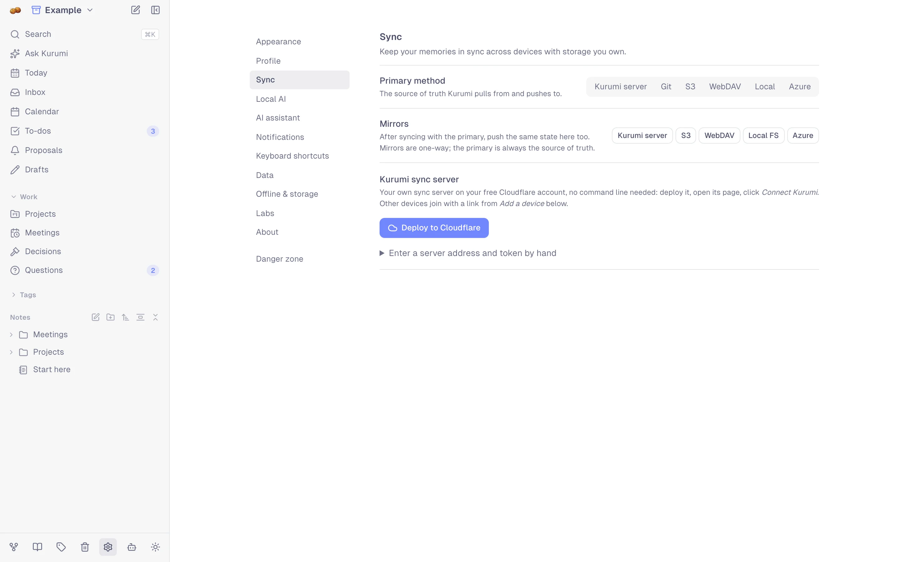

# Sync

Each device keeps its own full copy of your notes. Sync exchanges copies
through storage **you** choose, and merges them so edits from every
device survive: there's no Kurumi account or Kurumi cloud.

<picture>
  <source media="(prefers-color-scheme: dark)" srcset="images/settings-sync-dark.webp">
  
</picture>

## Pick a method

| Method | Good for | Setup |
|--------|----------|-------|
| **Kurumi server** | Most people: phone + laptop, no command line | [One click on a free Cloudflare account](sync-server.md) |
| **Local** + [sync agent](../agent/README.md) | A git repo of plain Markdown at work, using your own git and SSH keys | A folder and one command |
| **Git** | A git repo, from the browser alone | A repo and a personal access token |
| **S3** | Storage you already have (AWS, R2, MinIO, Backblaze, …) | Endpoint, bucket, keys |
| **WebDAV** | Nextcloud, Synology, ownCloud | Address, user, password |
| **Azure** | Azure Blob Storage | Account URL, container, SAS token |
| **Local** alone | One computer, a backup folder, or a folder another tool syncs | Choose a folder (Chrome/Edge) |

Choose the **primary method** in Settings → Sync. **Mirrors** (optional)
receive a copy after every successful sync, one way, e.g. a nightly
backup to S3 while the Kurumi server is primary. Git can't be a mirror.

## When sync runs

Once a method is set up, Kurumi syncs:

- a few seconds after you stop typing;
- when you come back to the app (tab or window shown again);
- when the device comes back online (sync waits while offline; the sync
  button says *Offline*);
- when you press the sync button.

Two syncs are at least 10 seconds apart.

## What's synced

- **The database:** every vault, note, folder, person, to-do, project,
  meeting, decision and question, as one file.
- **Files:** images, recordings and attachments of the vault you're in,
  each stored once. A file that hasn't arrived yet shows a notice instead
  of a broken link.
- **Not synced:** settings that belong to a device (theme, shortcuts,
  AI keys, local models, your profile names).

## How edits merge

The database is a CRDT ([Automerge](https://automerge.org/)): each
device records its changes, and merging two copies replays both sides.
Edits to different notes, or different parts of a note, all survive. If
two devices change the same text at the same moment, both changes are
kept; for a single value like a status or a due date, one of the two
wins, the same one on every device.

Two copies that never synced before (Kurumi used on two devices before
setting up sync) are combined record by record, keeping the newer
version of each. Kurumi also does this when one device has
[optimized](offline.md#optimize-a-big-vault) the vault and another hasn't
synced since.

A copy made by a newer Kurumi version is never merged into an older app:
the older one asks you to reload and update first.

## Method details

### Kurumi server

A Cloudflare Worker and an R2 bucket on your own account. See
[Your own sync server](sync-server.md). Supports
[end-to-end encryption](encryption.md).

### Git

Settings → Sync → Git: repository URL (GitHub, GitLab or Codeberg),
branch, and a personal access token with read/write access to that repo.

- Notes are written as Markdown files mirroring your folders, plus
  `.kurumi/metadata.json` (folders, people, events, to-dos) and
  `.kurumi/blobs/` (files).
- The browser talks to the git host through a CORS proxy
  (`cors.isomorphic-git.org`), and the token is stored in the browser.
  If either is a problem (often at work), use **Local + the sync agent**.
- When the same note was changed on both sides since the last sync,
  Kurumi shows both versions side by side and lets you pick or combine.

### Local folder + sync agent

Settings → Sync → Local: choose a folder (Chrome and Edge). Kurumi writes
`kurumi-sync.bin` (the database) and a Markdown copy of the vault; turn on
**Write all vaults** for one subfolder per vault.

Kurumi also reads the folder back:

- editing a note's text or tags in the `.md` file changes the note;
- a new `.md` file becomes a note, a new folder becomes a folder, and with
  *Write all vaults* a new top-level folder becomes a vault.

The [sync agent](../agent/README.md) commits that folder and pushes and
pulls it with your machine's git. It merges `kurumi-sync.bin` with the
same CRDT merge, so edits from several computers survive.

### S3, WebDAV, Azure

Fill in the connection details and press **Test connection**. All three
support
[end-to-end encryption](encryption.md).

## Encryption

With the Kurumi server, S3, WebDAV and Azure, a sync passphrase seals the
database and files before they leave the device. Git and the local folder
stay plain Markdown, on purpose. See [End-to-end encryption](encryption.md).
