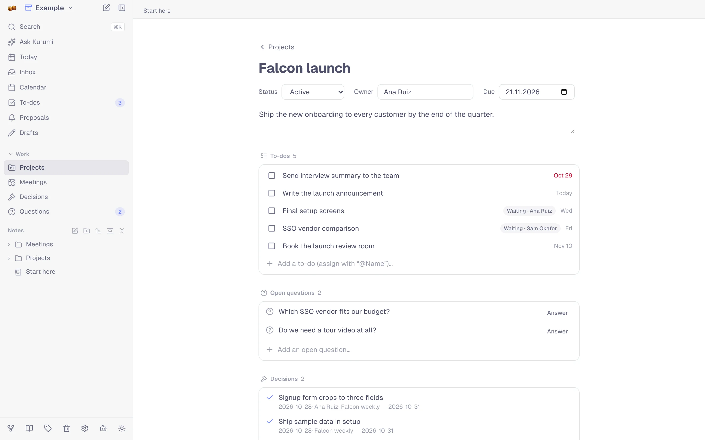
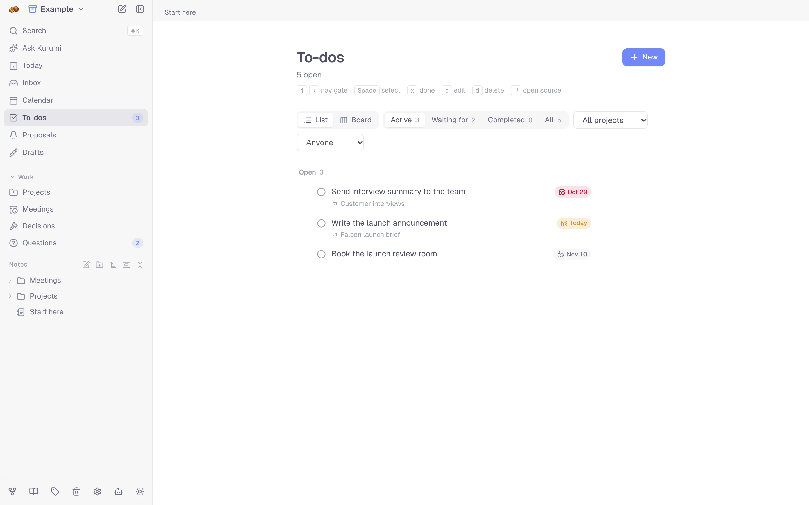
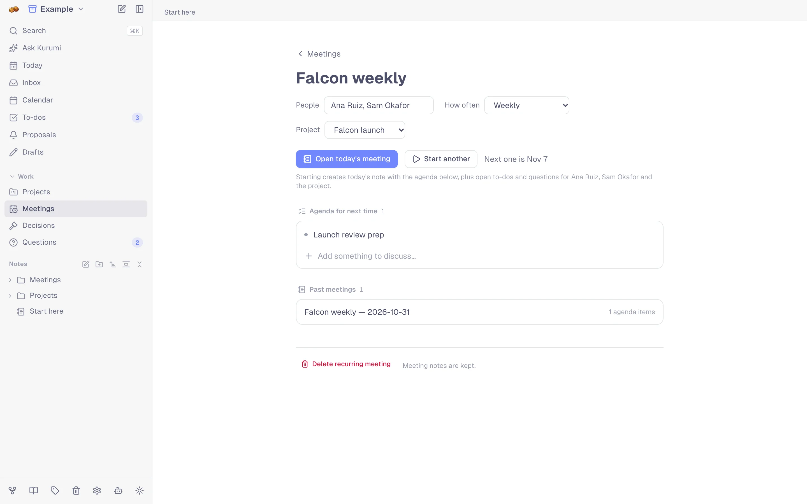

# Work

Kurumi keeps the things that come out of notes and meetings (to-dos,
decisions, open questions, agendas) as records of their own, linked back
to where they came from. The **Work** section of the sidebar holds them.

## Projects

`/projects`: each project has a status, owner, due date and description,
and one page with everything that belongs to it:

- notes that name the project (the chips under a note's title);
- to-dos, from those notes or added directly;
- open questions and decisions;
- its recurring meetings.

Project names your notes already use but that aren't projects yet are
suggested at the top of `/projects`.

<picture>
  <source media="(prefers-color-scheme: dark)" srcset="images/project-dark.webp">
  
</picture>

## To-dos

`/actions` (`Cmd/Ctrl+Shift+A`). To-dos come from meeting summaries,
approved reminder proposals, or you. Each has a status (open, in
progress, done, cancelled), an optional due date, recurrence and
assignee. Add one with `@Name` in the text to assign it.

- **Tabs:** Active, Waiting for, Completed, All.
- **Views:** a list, or a board with Open / In progress / Done columns
  (drag cards, or use the arrows).
- **Filters:** by project (through the note it came from) and assignee.
- **Keyboard:** `j`/`k` to move, `Space` to select several, `x` done,
  `e` edit, `d` delete, `Enter` opens the source note.

Today's and overdue to-dos are also on the home page and in the app icon
badge.

<picture>
  <source media="(prefers-color-scheme: dark)" srcset="images/todos-dark.webp">
  
</picture>

### Waiting for

A to-do assigned to someone else is something you're waiting for. Put
your own name(s) in **Settings → Profile** so Kurumi can tell the
difference. The *Waiting for* tab groups them by person, and each
[person page](organize-and-recall.md#people) shows what's waiting on
them.

## Recurring meetings

`/meetings`: a 1:1 or weekly sync with its people, rhythm, project and a
running **agenda**. Add agenda items between meetings, from the meeting
page or from any note (⋯ → *Add to a meeting agenda*). *Start meeting* creates the
meeting note with:

- the open agenda;
- open to-dos and questions for its people and project.

Past meetings are listed below.

<picture>
  <source media="(prefers-color-scheme: dark)" srcset="images/meeting-series-dark.webp">
  
</picture>

## Decisions

`/decisions`: what was decided, when and why, with a link to the note.
Meeting summaries add their decisions here by themselves; from any note,
⋯ → *Log a decision*.

## Open questions

`/questions`: questions stay open until answered or dropped. Meetings
add their unresolved questions by themselves; from any note, ⋯ → *Add an
open question*.

## Reminder proposals

`/proposals`: when Kurumi processes a recording (or you choose ⋯ → *Find
reminders & drafts* on a note), it suggests follow-ups with a time ("send the deck to Ana on
Friday"). Nothing happens until you review them:

- **Approve** (`a`) creates a to-do with that due date.
- **Reject** (`r`), **Snooze** (`s`), reopen or delete.

## Draft proposals

`/drafts`: email and calendar-event drafts Kurumi found in a recording
("I'll email the summary to the team"). Copy one (`c`) into your mail or
calendar app; Kurumi never sends anything itself.

## Inbox

`/inbox` (`Cmd/Ctrl+Shift+I`): one list of what needs attention:
overdue and due to-dos, proposals waiting for review, recordings without
a summary, notes without tags.

## Notifications

Settings → **Notifications** turns on browser alerts for to-dos as they
come due. Each alert has **Mark done** and **Snooze 1h**; clicking it
opens To-dos. With the app installed (Chrome/Edge), Kurumi can also check
in the background. See [Offline & storage](offline.md#what-each-platform-supports).

## Focus timer

A Pomodoro timer you can link to a to-do; it shows a thin progress bar
across the app, with pause, resume and a chime.

## Undo

Deleting a to-do, proposal or draft, changing a status, or a bulk action
can be undone for 5 minutes: from the toast, or with `Cmd/Ctrl+Z`
anywhere. Deleted notes go to the Trash.
